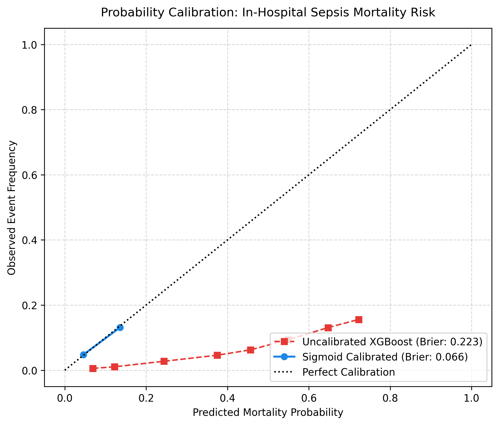
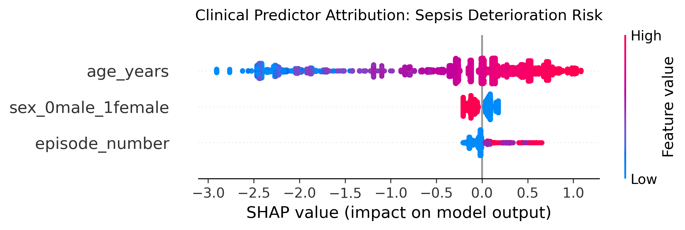

# Sepsis Survival XAI: Calibrated and Explainable Mortality Risk from Minimal Clinical Records

A reproducible benchmark that predicts **in-hospital sepsis mortality** from three minimal clinical variables (age, sex, sepsis episode number) using an imbalance-aware **XGBoost** model, **post-hoc sigmoid (Platt) calibration**, **bootstrapped 95% confidence intervals**, and **SHAP** explanations at both cohort and patient level.

<p align="center">
  
  
</p>

## Dataset

Sepsis Survival Minimal Clinical Records (primary cohort, 110,204 admissions, Norway 2011 to 2012), introduced by Chicco and Jurman, *Scientific Reports* 10, 17156 (2020), [doi:10.1038/s41598-020-73558-3](https://doi.org/10.1038/s41598-020-73558-3). Available from the [UCI ML Repository (id 827)](https://archive.ics.uci.edu/dataset/827) and Kaggle. Download instructions are in [`data/README.md`](data/README.md). The data is **not** redistributed in this repo.

| Column | Description |
|---|---|
| `age_years` | Age at admission |
| `sex_0male_1female` | 0 = male, 1 = female |
| `episode_number` | Sepsis episode count for the patient |
| `hospital_outcome_1alive_0dead` | Outcome (flipped internally so 1 = death) |

## Method

1. **Split**: stratified 70 / 15 / 15 into train, calibration/validation, and held-out test.
2. **Model**: XGBoost (150 trees, depth 3, lr 0.03) with `scale_pos_weight = neg/pos` for the 7.35% mortality rate.
3. **Calibration**: sigmoid calibration fitted on the validation split (`FrozenEstimator` for sklearn >= 1.6, `cv="prefit"` otherwise).
4. **Threshold**: F1-optimal cutoff from the precision-recall curve on the **validation** split.
5. **Uncertainty**: 500-sample bootstrap 95% CIs for ROC-AUC and PR-AUC on the test split.
6. **Explainability**: SHAP TreeExplainer summary plot and a per-patient waterfall "audit trail" (log-odds scale).

## Results (original notebook run, test n = 16,531, 1,216 deaths)

| Metric | Value |
|---|---|
| ROC-AUC | 0.7032 (95% CI 0.6901 to 0.7164) |
| PR-AUC | 0.1337 (prevalence baseline 0.0735) |
| Brier, uncalibrated | 0.2232 |
| Brier, sigmoid calibrated | 0.0659 |
| F1-optimal threshold | 0.1041 |
| Mortality recall / precision / F1 at threshold | 0.53 / 0.14 / 0.22 |
| Mortality recall at default 0.50 | 0.00 |

> **Note on reproducibility.** The notebook in `notebooks/` tuned the decision threshold on the **test** split, so its threshold-dependent rows (last two) are slightly optimistic. The modular pipeline in `src/` tunes the threshold on the validation split instead. Re-run `scripts/run_pipeline.py` and update this table with the numbers in `results/metrics.json` before citing them. ROC-AUC, PR-AUC and Brier are threshold-free and unaffected.

### Interpretation

* Age dominates attribution; higher age monotonically increases predicted risk.
* Female sex shows a small protective contribution; higher episode number a small positive one.
* The uncalibrated model is heavily over-confident because `scale_pos_weight` shifts probabilities upward; calibration fixes this, at the cost of compressing calibrated predictions into a narrow 0.05 to 0.15 range.
* SHAP values are in **log-odds** units of the uncalibrated booster, not calibrated probabilities.

## Repository structure

```
sepsis-survival-xai/
├── README.md
├── LICENSE
├── requirements.txt
├── .gitignore
├── data/
│   ├── README.md                 # how to download the dataset
│   └── raw/                      # place the CSV here (git-ignored)
├── notebooks/
│   └── 01_sepsis_survival_benchmark.ipynb   # original Kaggle notebook with outputs
├── src/sepsis_xai/
│   ├── __init__.py
│   ├── data.py                   # loading, target flip, stratified split
│   ├── model.py                  # XGBoost + sigmoid calibration
│   ├── evaluate.py               # threshold, bootstrap CIs, metrics
│   └── plots.py                  # calibration, SHAP summary, SHAP waterfall
├── scripts/
│   └── run_pipeline.py           # end-to-end CLI
├── results/
│   ├── metrics_notebook.json     # metrics from the original notebook run
│   └── figures/
│       ├── calibration_curve.png
│       ├── shap_summary.png
│       └── shap_patient_waterfall.png
└── tests/
    └── test_pipeline.py          # synthetic-data smoke tests
```

Outputs are written to `results/metrics.json` and `results/figures/`.

## Limitations

* Only three predictors, so discrimination is modest (AUC about 0.70); this is a calibration and explainability benchmark, not a deployable triage tool.
* Rows are admissions, not unique patients; the random split can place episodes of the same patient in train and test.
* Single-country retrospective cohort; external validation (e.g. the study cohort from the same paper) has not yet been run.
* Sex is used as a predictor; any clinical use would need a fairness audit.

## Citation

If you use this code, please cite the dataset paper:

```bibtex
@article{chicco2020survival,
  title   = {Survival prediction of patients with sepsis from age, sex, and septic episode number alone},
  author  = {Chicco, Davide and Jurman, Giuseppe},
  journal = {Scientific Reports},
  volume  = {10},
  pages   = {17156},
  year    = {2020},
  doi     = {10.1038/s41598-020-73558-3}
}
```

## Author

Faiza Binte Zaman

## License

MIT, see [LICENSE](LICENSE).
